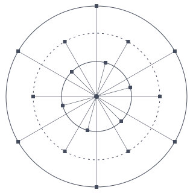

# The Lightfielder Project

## Multi-view workflow automation for volumetric post-production

Lightfielder (aka "LF") is an LGPL-licensed open-source hybrid computer-vision IDE and digital content creation (DCC) toolset developed by Andrew Hazelden. Designed to unify volumetric video content creation and XR post-production. The current Lightfielder public beta release cycle is aimed at a professional audience that is already working in the 3D graphics and immersive media sector.

## I'm a Lightfielder, eh?

You might be. Are you a tech artist, photographer, or filmmaker working with multi-view content in the plenoptic imaging domain? Do you frequently capture or process lightfield data? If YES, then you can easily use the colloquial term "Lightfielder" to describe your craft.

## What is a Lightfield Capture of a Scene?

Lightfield recordings of a real-world or virtual scene provide a unique experience compared to traditional legacy VR/XR media types (like 360VR, 180VR, Fulldome, 3DTV, or Spatial Media).

When digitized, a lightfield based 3D scene-graph stores the captured content using a data structure that holds the individual samples of light rays. Each ray has a unique light intensity property and a light ray direction property that indicates the angle that the light beam is travelling along.

This allows the observer of a lightfield scene asset to experience free-view motion (aka 6DoF navigation) when viewing the digital environment. The observer is able to interactively re-adjust the synthetic camera properties such as aperture, exposure, colour temperature, and shutter angle to sculpt the final cinematic result. A lightfield photography/filmmaking approach can be used to display a still representation of a scene (freezing a single moment in time), or a full motion version of the scene which supports narrative storytelling goals.
